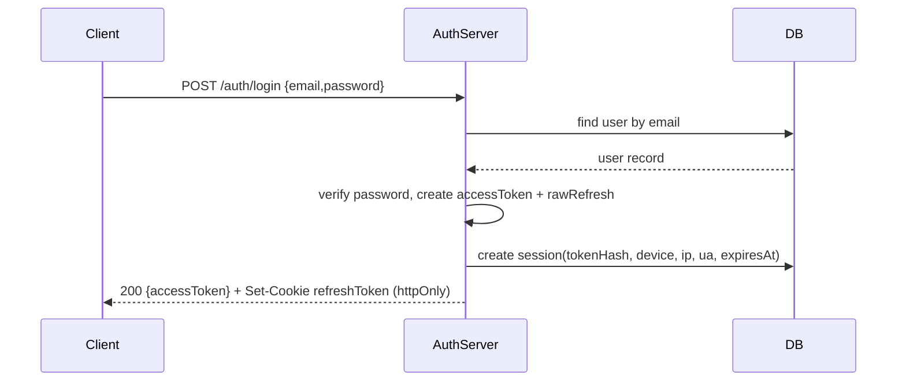
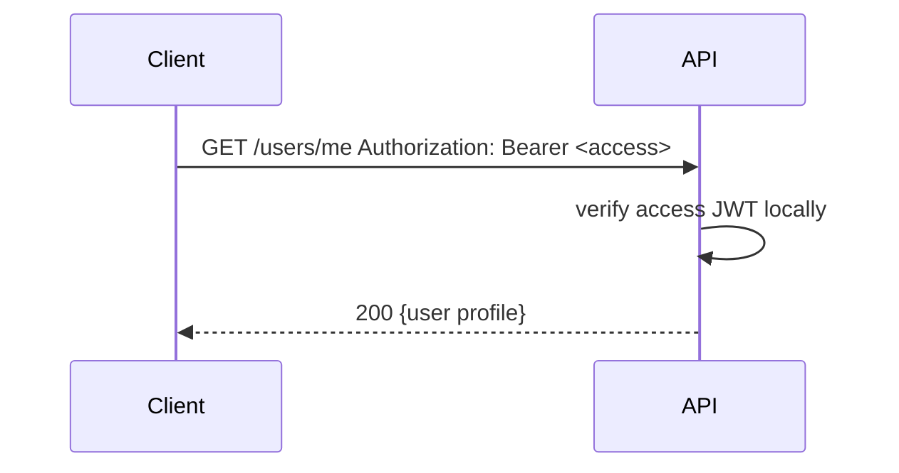
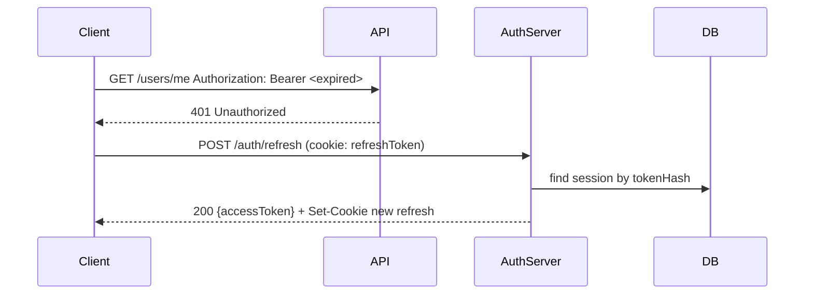
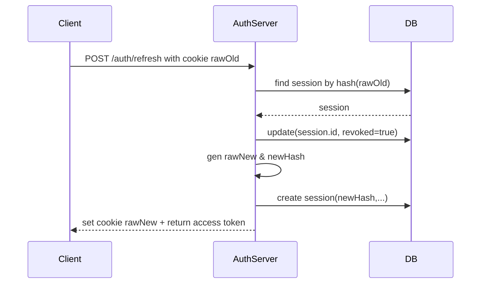
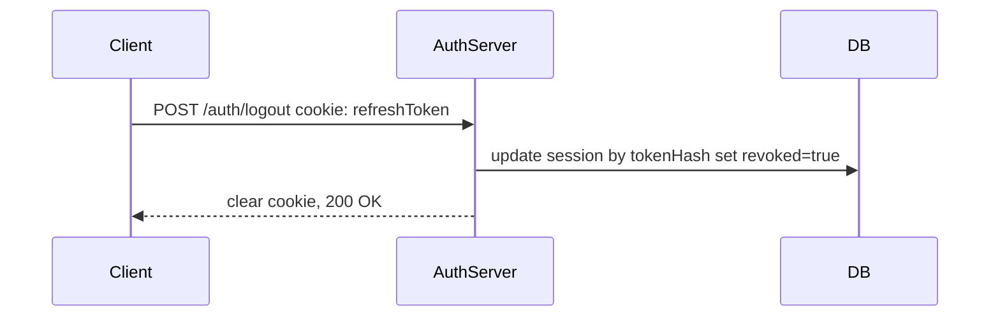
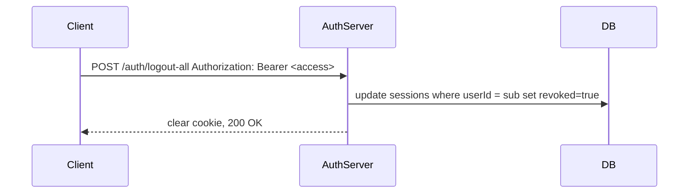
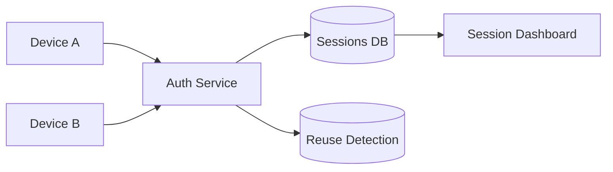
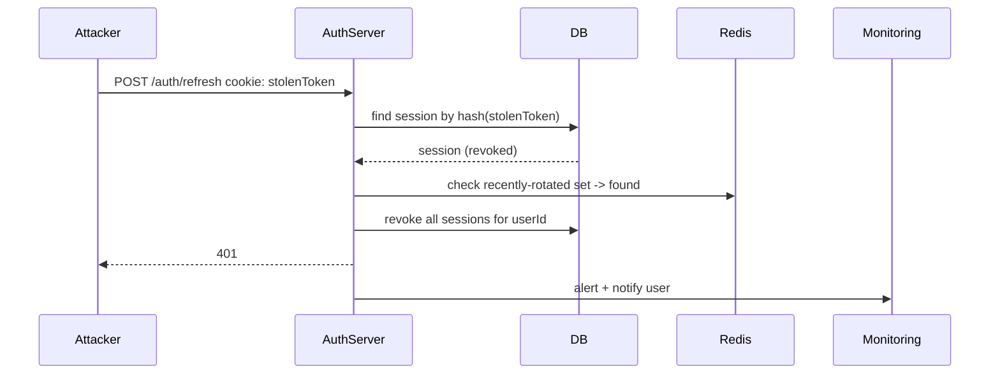

# Refresh Token Authentication — The Definitive Single-File Guide

This single README is the canonical, FAANG-level engineering guide for building secure, scalable authentication using short-lived access tokens and rotating refresh tokens. It covers concepts, architecture, production-ready patterns, concrete Express and Nest implementations, step-by-step flows, mermaid diagrams, and operational guidance.

## Table of Contents

- [Executive Summary](#executive-summary)
- [What Are Refresh Tokens?](#what-are-refresh-tokens)
- [Why Refresh Tokens Exist](#why-refresh-tokens-exist)
- [Access Token vs Refresh Token](#access-token-vs-refresh-token)
- [Why Not Just Use Long JWTs?](#why-not-just-use-long-jwts)
- [Full Authentication Lifecycle](#full-authentication-lifecycle)
- [Core Concepts](#core-concepts)
- [Real World Architecture](#real-world-architecture)
- [Security Principles](#security-principles)
- [Refresh Token Rotation](#refresh-token-rotation)
- [Reuse Detection](#reuse-detection)
- [Multi Device Sessions](#multi-device-sessions)
- [Logout Strategy](#logout-strategy)
- [Logout All Devices Strategy](#logout-all-devices-strategy)
- [Database Design](#database-design)
- [ExpressJS Implementation](#expressjs-implementation)
- [NestJS Implementation](#nestjs-implementation)
- [Flow Diagrams](#flow-diagrams)
  - [Login Flow](#login-flow)
  - [Protected Route Flow](#protected-route-flow)
  - [Expired Access Token Flow](#expired-access-token-flow)
  - [Refresh Token Rotation Flow](#refresh-token-rotation-flow)
  - [Logout Flow](#logout-flow)
  - [Logout All Devices Flow](#logout-all-devices-flow)
  - [Multi Device Sessions](#multi-device-sessions-flow)
  - [Token Reuse Attack Detection](#token-reuse-attack-detection)
- [API Endpoints](#api-endpoints)
- [Example Requests & Responses](#example-requests--responses)
- [Common Mistakes](#common-mistakes)
- [Troubleshooting](#troubleshooting)
- [Production Deployment](#production-deployment)
- [Scaling to Millions of Users](#scaling-to-millions-of-users)
- [Interview Questions](#interview-questions)
- [Further Improvements](#further-improvements)

## Executive Summary

This guide explains why short-lived access tokens + rotating refresh tokens are the industry standard, and how to implement them securely and scalably. It includes practical, production-oriented patterns for Express + TypeScript and NestJS + TypeScript, session modelling, reuse detection, logout flows, and scaling strategies used at large platforms.

## What Are Refresh Tokens?

- Long-lived credentials issued to clients to obtain new short-lived access tokens without re-authentication.

## Why Refresh Tokens Exist

- They enable short-lived access tokens (low blast radius) while preserving good user experience by allowing silent re-authentication via refresh tokens.

## Access Token vs Refresh Token

- Access Token: JWT, short TTL (e.g., 15m), used for API calls.
- Refresh Token: opaque random string (recommended), longer TTL (7–30d), stored securely and rotated.

## Why Not Just Use Long JWTs?

- Long-lived JWTs are irreversible if leaked; refreshing + rotating reduces exposure and enables server-side revocation.

## Full Authentication Lifecycle

1. Login: issue access + refresh.
2. Use access for APIs until expiry.
3. Refresh: exchange refresh for new access (and rotate refresh).
4. Logout: revoke single session; logout-all: revoke every session.

## Core Concepts

- Opaque refresh tokens (random) with hashed storage.
- Rotation: single-use refresh tokens.
- Reuse detection: Redis-based ephemeral sets to detect reuse.
- Sessions: per-device session records with metadata.

## Real World Architecture

- Auth Service: issue/rotate/revoke tokens.
- DB: persistent store (Postgres) for users & sessions.
- Redis: reuse detection, revocation cache, rate-limit counters.
- API Gateway: edge-level access token validation.
- Monitoring & alerting for suspicious flows.

## Security Principles

- Short access token TTL; refresh rotation; hashed refresh tokens; secure cookie storage; CSRF/XSS mitigations; rate-limiting; audits and alerts.

## Refresh Token Rotation

- On `/auth/refresh` use: mark old session revoked, create new session with new tokenHash, return raw new refresh in httpOnly cookie and a new access token.
- Store old hash in Redis for reuse detection.

## Reuse Detection

- On rotation, insert old tokenHash into Redis `recently_rotated:{userId}` with TTL.
- If a refresh token arrives whose hash exists in `recently_rotated`, treat as theft: revoke all sessions and alert.

## Multi Device Sessions

- One session per device/login; users can list and revoke per-device sessions. Each session stores `deviceName`, `ipAddress`, `userAgent`, `expiresAt`, `revoked`.

## Logout Strategy

- `POST /auth/logout`: revoke the session linked to the request's refresh cookie and clear cookie.

## Logout All Devices Strategy

- `POST /auth/logout-all`: require access token -> revoke all sessions for `userId`.

## Database Design

Practical models (Prisma-like):

```
model User {
  id           String   @id @default(cuid())
  email        String   @unique
  passwordHash String
  role         String   @default("user")
  createdAt    DateTime @default(now())
  sessions     Session[]
}

model Session {
  id         String   @id @default(cuid())
  userId     String
  user       User     @relation(fields: [userId], references: [id])
  tokenHash  String   @unique
  deviceName String?
  ipAddress  String?
  userAgent  String?
  expiresAt  DateTime
  revoked    Boolean  @default(false)
  createdAt  DateTime @default(now())
}
```

## ExpressJS Implementation

Stack: `express`, `typescript`, `jsonwebtoken`, `bcrypt`, `prisma`/`@prisma/client`, `cookie-parser`, `helmet`, `cors`, `express-rate-limit`, `zod`, `dotenv`.

Folder structure (recommended):

```
src/
  auth/
    auth.controller.ts
    auth.service.ts
    auth.routes.ts
    dto/
  users/
  sessions/
  middleware/
    auth.middleware.ts
  utils/
    jwt.ts
  config/
  index.ts
```

Key points:

- Controllers: HTTP -> service.
- Services: token gen, hashing, DB ops, rotation — pure and testable.
- Middleware: `requireAuth` verifies access JWT; `requireRole` enforces RBAC.
- Cookie: set `refreshToken` `HttpOnly; Secure; SameSite=Lax` (production `Secure`).

Code sketch (utils/jwt.ts):

```ts
import jwt from "jsonwebtoken";
import crypto from "crypto";
export const signAccessToken = (payload) =>
  jwt.sign(payload, process.env.JWT_ACCESS_SECRET!, { expiresIn: "15m" });
export const genRefreshRaw = () => crypto.randomBytes(64).toString("hex");
export const hashToken = (raw: string) =>
  crypto.createHash("sha256").update(raw).digest("hex");
```

Rotation logic (auth.service): revoke old session, create new session with hashed new token, set cookie, return new access.

## NestJS Implementation

Stack: `@nestjs/common`, `@nestjs/jwt`, `@nestjs/passport`, `passport-jwt`, `bcrypt`, `@prisma/client` or `typeorm`, `class-validator`, `class-transformer`.

Folder structure (recommended):

```
src/
  auth/
    dto/
    auth.controller.ts
    auth.service.ts
    jwt.strategy.ts
    guards/
  users/
  sessions/
  common/
  config/
  main.ts
```

Key points:

- Use DI to inject Prisma client/service.
- `AuthService` implements same rotation and hashing logic.
- Guards (`JwtAuthGuard`, `RolesGuard`) protect routes.
- DTOs + Pipes validate incoming payloads.

## Flow Diagrams

All diagrams below are Mermaid. Use a renderer that supports Mermaid.

### Login Flow



### Protected Route Flow



### Expired Access Token Flow



### Refresh Token Rotation Flow



### Logout Flow



### Logout All Devices Flow



### Multi Device Sessions



### Token Reuse Attack Detection



## API Endpoints

- POST /auth/register
- POST /auth/login
- POST /auth/refresh
- POST /auth/logout
- POST /auth/logout-all
- GET /users/me
- GET /admin/dashboard

## Example Requests & Responses

Register

```bash
curl -X POST https://api.example.com/auth/register \
  -H "Content-Type: application/json" \
  -d '{"name":"Alice","email":"alice@example.com","password":"Str0ngP@ss!" }'
```

Response 201

```json
{ "id": "cuid_xxx", "email": "alice@example.com", "name": "Alice" }
```

Login

```bash
curl -i -X POST https://api.example.com/auth/login \
  -H "Content-Type: application/json" \
  -c cookiejar.txt \
  -d '{"email":"alice@example.com","password":"Str0ngP@ss!","deviceName":"laptop"}'
```

Response 200 (body)

```json
{ "accessToken": "eyJhbGciOi..." }
```

Response headers: `Set-Cookie: refreshToken=<raw>; HttpOnly; Secure; SameSite=Lax; Max-Age=604800`

Refresh

```bash
curl -X POST https://api.example.com/auth/refresh \
  -b cookiejar.txt -c cookiejar.txt
```

Response 200

```json
{ "accessToken": "eyJhbGciOi..." }
```

## Common Mistakes

- Storing raw refresh tokens in DB (danger: DB leak exposes usable tokens).
- Putting refresh token into localStorage in browsers (exposes to XSS).
- Not rotating refresh tokens (allows replay attacks).
- Using the same refresh token across devices (session mixing).
- Not rate-limiting /auth endpoints (allows brute force).

## Troubleshooting

- Cookie not present on client: ensure `credentials: 'include'` in fetch/axios and server CORS has `credentials: true`.
- Invalid refresh token: ensure you hash the incoming token with SHA-256 before DB lookup and that the DB value stores the hash.
- Reuse detected unexpectedly: check clock skew, ensure tokens are rotated atomically, and ensure cookie updates reach client.

## Production Deployment

- DB: Postgres or similar, with proper migration & backups (Prisma migrations).
- Secrets: manage via secrets manager; rotate periodically; implement KID if using asymmetric keys.
- Cookies: `Secure` + `HttpOnly`. Use `SameSite=Lax` for compatibility; `Strict` for tighter CSRF protection.
- HTTPS: mandatory.
- Redis: use for reuse detection, revocation caches, and distributed rate-limit counters.
- Monitor: record events (login, refresh, logout, revoke) to SIEM and alarming system.

## Scaling to Millions of Users

- Edge validation: validate access tokens in API Gateway using public keys (if asymmetric JWTs).
- Persist session metadata in sharded store; use Redis for ephemeral revocation caches and reuse detection.
- Partition sessions table by userId or time; index `userId`, `tokenHash`.
- Rate limit per IP and per account; use progressive throttling and queueing for abusive behavior.

## Interview Questions

- Why rotate refresh tokens? How does rotation reduce replay attacks?
- How would you detect refresh token theft and what automated actions would you take?
- Opaque vs JWT refresh tokens: tradeoffs?
- How would you revoke an access token immediately in a high-scale system?

## Further Improvements

- Device attestation & binding (mobile).
- Add MFA on suspicious refresh attempts.
- Implement jti-based access revocation cache for immediate JWT revocation.
- Provide session analytics & alerting.

---

If you'd like, I can next:

- Add a Postman collection and example curl commands.
- Implement the Nest guards/DTOs and complete the Express/Nest reference code with Redis reuse detection and tests.

Which do you want me to do next?

# Refresh Token Authentication — Single Consolidated Guide

This single README consolidates everything: concepts, security guidance, full implementation details, setup, API docs, example requests, and advanced topics for both the Express and Nest implementations included in this repo.

Table of contents

- Introduction
- Core Concepts
  - What Are Refresh Tokens?
  - Why Refresh Tokens Matter
  - Access Token vs Refresh Token
  - Token Lifecycle
  - Stateless vs Stateful
  - Rotation & Reuse Detection
- Security & Best Practices
  - Storage, Cookies, CSRF, XSS
  - Hashing refresh tokens
  - Rate limiting & brute-force protections
  - Secret rotation & auditing
- Production Architecture
- ExpressJS Implementation (detailed)
  - Folder structure
  - Prisma schema
  - Setup & run
  - API routes, request/response examples
  - Important files explained
- NestJS Implementation (detailed)
  - Folder structure
  - Prisma schema
  - Setup & run
  - API routes, request/response examples
  - Important files explained
- Testing & Postman
- Deployment notes
- Advanced topics
- Troubleshooting & FAQ
- Interview questions

## Introduction

This repository demonstrates a production-oriented refresh token strategy using two server frameworks: Express and NestJS. Each implementation shows:

- Short-lived JWT access tokens (15 minutes)
- Long-lived opaque refresh tokens (7 days default)
- Hashed refresh-token storage in DB (SHA-256)
- Refresh rotation: revoke old refresh tokens and issue new ones
- Multi-device sessions with device metadata
- Logout (single device) and logout-all (revoke all sessions)
- Role-based access control (admin route)
- Input validation, error handling, logging, and rate limiting

## Core Concepts

What Are Refresh Tokens?

- Long-lived credentials used to obtain new access tokens without re-authenticating.

Why Refresh Tokens Matter

- Access tokens are intentionally short-lived to limit blast radius if leaked. Refresh tokens allow the user to stay logged in without storing long-lived access tokens.

Access Token vs Refresh Token

- Access Token: JWT, carries claims (sub, role), sent in Authorization header.
- Refresh Token: opaque random string stored secure (httpOnly cookie). Only sent to /auth/refresh.

Token Lifecycle

- Login -> issue access + refresh.
- Access token used for API calls until expiry.
- On expiry, client calls /auth/refresh -> server validates refresh, rotates, and returns new access.
- Logout revokes single refresh; logout-all revokes all sessions.

Stateless vs Stateful

- Stateless (JWT-only): scales easily but cannot revoke tokens early.
- Stateful (JWT + refresh sessions): store refresh hashes in DB for revocation, tracking, and session management (recommended).

Rotation & Reuse Detection

- Rotate refresh tokens on every use. On reuse of an already revoked token, flag potential theft and revoke all sessions.
- Use Redis with short TTL to detect rapid reuse patterns across regions.

## Security & Best Practices

- Store refresh tokens as httpOnly cookies (browser) with `SameSite=Lax` or `Strict` and `Secure` in production.
- Hash refresh tokens before storing (use SHA-256) to prevent raw token leakage from DB backups.
- Short-lived access tokens (15m). Long-lived refresh tokens (7d–30d) depending on UX needs.
- Implement rotation and mark previous refresh tokens as revoked.
- Rate-limit `/auth/login` and `/auth/refresh` endpoints; add exponential backoff.
- Use `bcrypt` for password hashing and strong cost factor (e.g., 10-12).
- Protect against CSRF when using cookies (SameSite helps; for cross-site flows add CSRF tokens).
- Log session creation, refresh, and revocation events; trigger alerts on suspicious patterns.

## Production Architecture

Minimal components:

- API Gateway (validates short-lived JWTs at edge) — caches public keys if using asymmetric JWTs.
- Auth Service (this repo's functionality) — issues and rotates tokens, persists hashed refresh tokens in DB.
- Data store (Postgres + Prisma) — store users and session records.
- Redis — store revocation lists, short-lived reuse detection sets, and rate-limiter counters.
- Monitoring & SIEM — track suspicious refresh activity.

## ExpressJS Implementation (detailed)

Folder structure (key files)

- express-app/
  - package.json
  - tsconfig.json
  - .env.example
  - prisma/schema.prisma
  - src/
    - index.ts (app entry)
    - routes/auth.ts (register/login/refresh/logout)
    - routes/users.ts (protected routes)
    - middleware/auth.ts (access token middleware + role guard)
    - utils/jwt.ts (access signing, refresh generation, hashing)

Prisma schema

- See [express-app/prisma/schema.prisma](express-app/prisma/schema.prisma) — defines `User` and `Session` models.

Setup & run

1. Clone repo and open terminal.
2. Install and run Express app:

```bash
cd express-app
npm install
cp .env.example .env
npx prisma generate
npx prisma db push
npm run dev
```

.env variables of interest (see `express-app/.env.example`):

- `DATABASE_URL` — e.g. `file:./dev.db` for SQLite or Postgres URL for production
- `JWT_ACCESS_SECRET` — strong secret for signing access tokens
- `JWT_REFRESH_SECRET` — (not required for opaque tokens but kept for extensibility)
- `ACCESS_TOKEN_EXPIRES` — `15m`
- `REFRESH_TOKEN_EXPIRES` — `7d`

API routes (Express)

- POST /auth/register
  - Body: { name, email, password }
  - Response: created user (id, email, name)

- POST /auth/login
  - Body: { email, password, deviceName? }
  - Response: { accessToken }
  - Side effect: sets `refreshToken` httpOnly cookie

- POST /auth/refresh
  - Cookie: `refreshToken` (httpOnly)
  - Response: { accessToken }
  - Side effect: rotates refresh cookie (new httpOnly cookie)

- POST /auth/logout
  - Cookie: `refreshToken` — revokes session associated with cookie

- POST /auth/logout-all
  - Authorization: Bearer <accessToken>
  - Response: { ok: true }
  - Side effect: revokes all sessions for the access token's user

- GET /users/me
  - Authorization: Bearer <accessToken>
  - Response: user profile

- GET /users/admin/dashboard
  - Authorization: Bearer <accessToken>
  - Requires role: `admin`

Example curl flows (Express)

1. Register

```bash
curl -X POST http://localhost:4000/auth/register \
	-H "Content-Type: application/json" \
	-d '{"name":"Alice","email":"alice@example.com","password":"secret123"}'
```

2. Login (receives access token and httpOnly refresh cookie)

```bash
curl -i -X POST http://localhost:4000/auth/login \
	-H "Content-Type: application/json" \
	-c cookie.txt \
	-d '{"email":"alice@example.com","password":"secret123","deviceName":"laptop"}'

# response body will include {"accessToken":"<JWT>"}
```

3. Call protected route

```bash
curl -H "Authorization: Bearer <ACCESS_TOKEN>" http://localhost:4000/users/me
```

4. Refresh (rotates refresh token)

```bash
curl -X POST http://localhost:4000/auth/refresh \
	-b cookie.txt -c cookie.txt
```

Important files explained (Express)

- [express-app/src/index.ts](express-app/src/index.ts) — configures middleware (Helmet, CORS, rate limiter), wires routers and starts server.
- [express-app/src/routes/auth.ts](express-app/src/routes/auth.ts) — core auth flows: registration, login (creates session with hashed refresh token), refresh (rotation), logout, logout-all.
- [express-app/src/utils/jwt.ts](express-app/src/utils/jwt.ts) — helper to sign access tokens and generate/ hash random refresh tokens. Refresh tokens are opaque random hex strings; their SHA-256 hash is stored in DB.
- [express-app/src/middleware/auth.ts](express-app/src/middleware/auth.ts) — `requireAuth` reads access token from `Authorization` header and attaches payload to `req.user`; `requireRole` enforces role-based access.
- [express-app/prisma/schema.prisma](express-app/prisma/schema.prisma) — `User`, `Session` models; session stores `tokenHash`, `deviceName`, `ipAddress`, `userAgent`, `expiresAt`, and `revoked`.

## NestJS Implementation (detailed)

Folder structure (key files)

- nest-app/
  - package.json
  - tsconfig.json
  - .env.example
  - prisma/schema.prisma
  - src/
    - main.ts
    - app.module.ts
    - auth/
      - auth.module.ts
      - auth.service.ts
      - auth.controller.ts
    - users/
      - users.module.ts
      - users.controller.ts

Prisma schema

- See [nest-app/prisma/schema.prisma](nest-app/prisma/schema.prisma) — same `User` and `Session` models as Express.

Setup & run

```bash
cd nest-app
npm install
cp .env.example .env
npx prisma generate
npx prisma db push
# Start dev server (using Nest CLI if available)
npm run start:dev
```

API routes (Nest) — same endpoints as Express. The Nest `AuthService` includes helpers for signing access tokens, generating refresh tokens, hashing them, storing sessions, and rotating on refresh.

Important files explained (Nest)

- [nest-app/src/auth/auth.service.ts](nest-app/src/auth/auth.service.ts) — service implementing register, validateUser, signAccessToken, signRefreshToken, hashToken, rotateRefreshSession.
- [nest-app/src/auth/auth.controller.ts](nest-app/src/auth/auth.controller.ts) — controller mapping HTTP endpoints to service calls. Uses httpOnly cookies for refresh tokens.

## Testing & Postman

I can add a Postman collection and a set of example requests (login/register/refresh/logout/protected). If you want that now, I will add `postman_collection.json` in the repo and example environment variables.

## Deployment notes

- Use Postgres (or other production-grade DB) instead of SQLite and run proper migrations with Prisma.
- Use HTTPS and set `Secure` cookie flag in production.
- Consider using Redis for:
  - Revocation lists and rapid reuse detection
  - Distributed rate-limiting counters
- Rotate signing keys and maintain a key-rotation strategy (key ids `kid` in JWT headers) so tokens can be validated after rotation for a short period.

## Advanced topics

- Redis refresh token storage and reuse detection: store recent token hashes with short TTL. On rotation, check whether an incoming refresh token's hash is present in the "already-rotated" set; if so, this indicates reuse.
- Multi-region auth: centralize session DB or use a replication strategy plus a global Redis for reuse detection.
- API Gateway: validate access tokens at the gateway for low-latency auth checks and forward the `sub` to microservices.
- Mobile flows: store refresh tokens in secure keystore/keychain and use device attestation if possible.
- Session dashboard: implement session listing (`GET /sessions`), allow device-based logout.
- Suspicious activity detection: on reused revoked refresh token -> revoke all sessions and notify user via email + forced password reset.

## Troubleshooting & FAQ

- "Cookie not sent on refresh": ensure client sets `credentials: 'include'` and server CORS has `credentials: true`.
- "Invalid refresh token": ensure you hash the incoming token with SHA-256 before DB lookup and that the DB value stores the hash.
- "Access token expired frequently": use refresh flow to obtain new access tokens; short access expiry is intentional for security.

## Interview Questions

- Why rotate refresh tokens? How does rotation reduce replay attacks?
- How would you detect refresh token theft and what automated actions would you take?
- Where to store refresh tokens in SPA vs mobile apps?
- Trade-offs between opaque and JWT refresh tokens.

## Next steps I can take for you

- Add a Postman collection and example environment file (I can create `/postman/refresh-auth.postman_collection.json`).
- Flesh out NestJS guards, DTOs, and validation (class-validator + pipes) for production readiness.
- Add Redis-based reuse detection and a basic `GET /sessions` endpoint to list and revoke sessions per-device.

Tell me which of the above you'd like me to do next and I will proceed.
